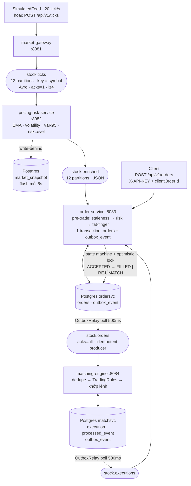
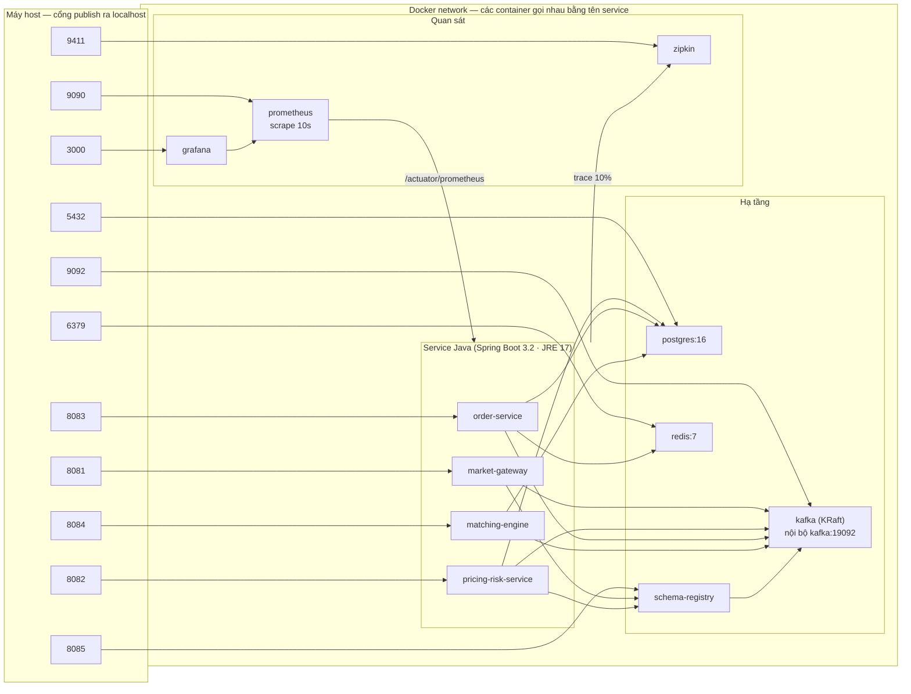
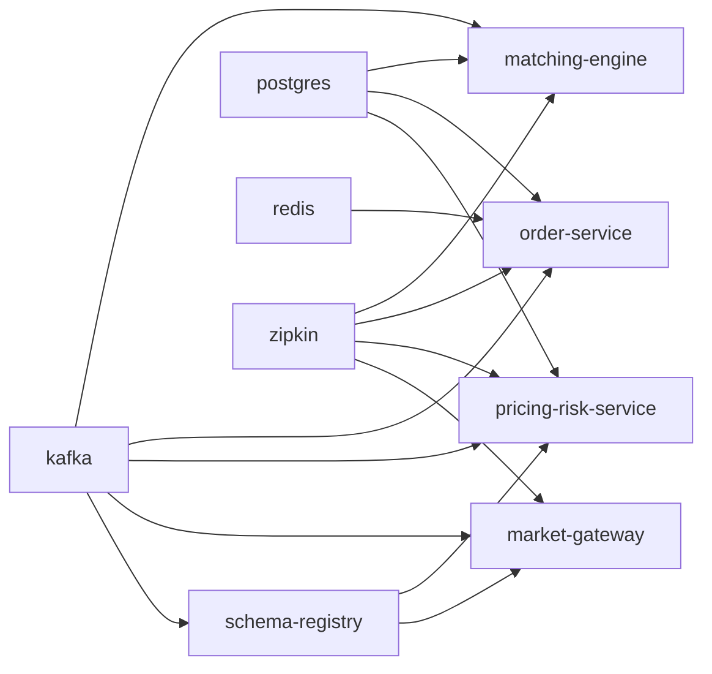
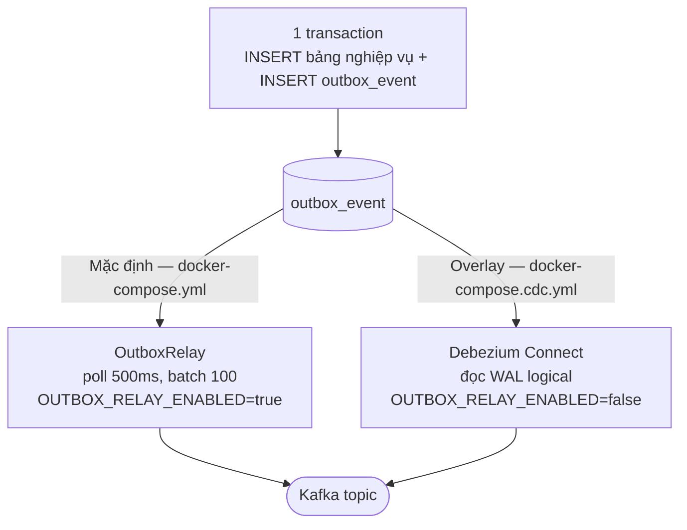

# DEPLOY-LOCAL — Hướng dẫn deploy hệ thống trên máy local

> Tài liệu này trả lời: **cần cài gì, gõ lệnh nào, theo thứ tự nào, và kiểm tra ra sao**
> để dựng toàn bộ `trading-system` chạy trên một máy.
>
> - Muốn hiểu **vì sao thiết kế như vậy** → `DESIGN-NOTES.md`
> - Muốn hiểu **code nằm ở đâu, sửa thế nào** → `GUIDE.md`
> - Muốn xem nhanh **lệnh curl demo** → `README_ARC.md`

Có 2 đường deploy, chọn 1:

| | Cách A — Docker Compose | Cách B — Thủ công từng service |
|---|---|---|
| Thời gian | ~10–20 phút (lần đầu build) | ~5 phút build + mở 4 terminal |
| Dùng khi | Chạy demo, xem toàn hệ, load test | Debug / sửa code 1 service, attach debugger IDE |
| Hạ tầng | Docker lo hết | Docker lo hạ tầng, service chạy bằng `java -jar` |

---

## 0. Yêu cầu máy

| Phần mềm | Phiên bản tối thiểu | Kiểm tra |
|---|---|---|
| Docker Desktop | 24+ (có `docker compose` v2) | `docker compose version` |
| JDK | 17+ (chỉ cần cho **Cách B**) | `java -version` |
| Maven | 3.9+ (chỉ cần cho **Cách B**) | `mvn -version` |
| `curl`, `jq` | bất kỳ | `curl --version` |
| `k6` | tuỳ chọn, chỉ để load test | `k6 version` |

**Tài nguyên:** cần tối thiểu **8 GB RAM** và **~10 GB đĩa trống** cấp cho Docker.
Stack gồm 11 container (Kafka, Postgres, Schema Registry, Redis, Zipkin,
Prometheus, Grafana + 4 service Java). Trên Docker Desktop vào
*Settings → Resources* nâng Memory lên ≥ 8 GB nếu đang để mặc định thấp hơn.

**Cổng phải trống trên host** — kiểm tra trước khi chạy:

```
9092  Kafka          5432  Postgres       8085  Schema Registry
6379  Redis          9411  Zipkin         9090  Prometheus
3000  Grafana        8081  market-gateway 8082  pricing-risk-service
8083  order-service  8084  matching-engine
```

Windows / PowerShell:
```powershell
foreach ($p in 9092,5432,8085,6379,9411,9090,3000,8081,8082,8083,8084) {
  $r = Get-NetTCPConnection -LocalPort $p -State Listen -ErrorAction SilentlyContinue
  if ($r) { "Port $p DANG BI CHIEM boi PID $($r.OwningProcess)" }
}
```

Linux / macOS:
```bash
for p in 9092 5432 8085 6379 9411 9090 3000 8081 8082 8083 8084; do
  lsof -nP -iTCP:$p -sTCP:LISTEN >/dev/null 2>&1 && echo "Port $p DANG BI CHIEM"
done
```

> Port 5432 hay bị Postgres cài sẵn trên máy chiếm, 3000 hay bị app Node chiếm.
> Nếu bị, hoặc tắt tiến trình đó, hoặc sửa phần `ports:` trong `docker-compose.yml`
> (chỉ đổi số **bên trái** dấu `:` — đó là cổng host).

---

## Cách A — Deploy bằng Docker Compose (khuyến nghị)

### A1. Build + khởi động toàn hệ

Từ thư mục `trading-system/`:

```bash
# Buoc 1: bat ha tang truoc - khong can build, len trong ~20 giay
docker compose up -d kafka postgres schema-registry redis zipkin prometheus grafana

# Buoc 2: build va bat 4 service Java
docker compose up -d --build
```

> **Vì sao tách 2 bước:** `docker compose up -d --build` build xong **toàn bộ**
> image rồi mới khởi động **bất kỳ** container nào. Grafana/Prometheus không cần
> build gì cả nhưng vẫn bị kẹt chờ 4 bản build Java phía trước — nghĩa là
> `localhost:3000` không vào được suốt 10–20 phút đầu. Tách ra thì xem được
> dashboard ngay trong lúc chờ build.

Lệnh build làm 3 việc:
1. Kéo image hạ tầng (Kafka, Postgres, Redis, Schema Registry, Zipkin, Prometheus, Grafana).
2. Build 4 image service từ `Dockerfile` dùng chung — mỗi service một lần
   `docker build --build-arg MODULE=<tên-module>`, bên trong là multi-stage:
   `maven:3.9-eclipse-temurin-17` biên dịch → `eclipse-temurin:17-jre` chạy jar.
3. Khởi động tất cả theo thứ tự `depends_on`.

**Lần đầu chạy sẽ lâu (10–20 phút)** vì Maven phải tải toàn bộ dependency cho
từng module. Các lần sau có Docker layer cache nên nhanh hơn nhiều.

Build riêng từng image (khi chỉ muốn rebuild 1 service):
```bash
docker build --build-arg MODULE=order-service -t trading/order-service:1.0.0 .
docker compose up -d --build order-service
```

### A2. Chờ hệ ổn định

```bash
docker compose ps
```

Chờ đến khi cả 11 service ở trạng thái `running`/`Up`. Service Java mất thêm
~30–45 giây sau khi container `Up` để Spring Boot khởi động xong, Flyway chạy
migration và Kafka consumer join group.

Theo dõi log đến khi thấy `Started ...Application`:
```bash
docker compose logs -f order-service matching-engine
```

### A3. Kiểm tra sức khoẻ (health check)

```bash
for p in 8081 8082 8083 8084; do
  echo -n "port $p: "; curl -s localhost:$p/actuator/health | jq -r .status
done
# Mong đợi: UP, UP, UP, UP
```

### A4. Kiểm tra luồng dữ liệu chạy thật

`market-gateway` có **feed giả lập** bật sẵn (`SIMULATED_FEED=true`), tự bơm
20 tick/giây cho 4 mã `VN30F2607`, `HPG`, `VCB`, `FPT`. Không cần làm gì thêm.

**1. Tick đã chảy đến pricing chưa:**
```bash
curl -s localhost:8082/api/v1/marketdata/HPG | jq
# Mong đợi: có lastPrice, ema, volatility, var95, riskLevel và timestamp mới
```
Nếu trả rỗng → chờ thêm 15 giây rồi gọi lại (cache enriched cần vài tick mới có dữ liệu).

**2. Đặt một lệnh và xem nó đi hết vòng saga:**

> ⚠️ **Không dùng được 4 mã của feed giả lập** (`HPG`, `VCB`, `FPT`, `VN30F2607`).
> Chúng luôn ở `riskLevel: HIGH` nên **mọi lệnh đều bị pre-trade check từ chối**
> với `RISK_LEVEL_HIGH` — xem mục *Lỗi đã phát hiện #2* để hiểu vì sao.
> Muốn chạy được đường happy path, dùng một **mã mới** với giá ổn định:

```bash
# Bom 6 tick gia y het nhau cho mot ma moi -> volatility = 0 -> riskLevel = LOW
for i in 1 2 3 4 5 6; do
  curl -s -o /dev/null -X POST localhost:8081/api/v1/ticks \
    -H 'Content-Type: application/json' \
    -d "{\"symbol\":\"DEMO1\",\"price\":28500.00,\"volume\":1000,\"eventTime\":$(date +%s%3N)}"
done
sleep 2
curl -s localhost:8082/api/v1/marketdata/DEMO1 | jq .riskLevel    # -> "LOW"

# Gio dat lenh moi duoc chap nhan
curl -s -X POST localhost:8083/api/v1/orders \
  -H 'Content-Type: application/json' -H 'X-API-KEY: demo-key' \
  -d '{"clientOrderId":"local-1","symbol":"DEMO1","side":"BUY","price":28500,"quantity":100,"accountId":"ACC1"}' | jq
# Mong đợi: HTTP 201, status = ACCEPTED
```

> Dữ liệu chỉ "tươi" trong 10 giây (`order.max-data-age-ms`). Nếu để lâu rồi mới
> đặt lệnh sẽ nhận `NO_FRESH_MARKET_DATA` — bơm lại tick rồi đặt ngay.

**3. Idempotency — gửi lại y hệt:**
```bash
# Chạy lại đúng lệnh trên -> trả về KẾT QUẢ CŨ, không tạo lệnh thứ hai
```

**4. Lệnh đã được khớp chưa:**
```bash
sleep 3
curl -s localhost:8084/api/v1/executions/local-1 | jq
# Mong đợi: đúng 1 execution
```

**5. Trạng thái cuối trong DB đã về FILLED chưa:**
```bash
docker compose exec postgres psql -U trading -d trading \
  -c "SELECT client_order_id, status, filled_qty, avg_fill_price FROM ordersvc.orders WHERE client_order_id='local-1';"
# Mong đợi: status = FILLED
```

**6. Đường từ chối (pre-trade check) — giá lệch >5%:**
```bash
curl -s -X POST localhost:8083/api/v1/orders \
  -H 'Content-Type: application/json' -H 'X-API-KEY: demo-key' \
  -d '{"clientOrderId":"local-2","symbol":"DEMO1","side":"BUY","price":99999,"quantity":100,"accountId":"ACC1"}' | jq
# Mong đợi: HTTP 422, lý do PRICE_DEVIATION
```

**7. Đường từ chối phía matching — sai lô chẵn (quantity 150):**
```bash
# Bom lai tick cho tuoi truoc (du lieu chi song 10 giay)
for i in 1 2 3; do
  curl -s -o /dev/null -X POST localhost:8081/api/v1/ticks \
    -H 'Content-Type: application/json' \
    -d "{\"symbol\":\"DEMO1\",\"price\":28500.00,\"volume\":1000,\"eventTime\":$(date +%s%3N)}"
done

curl -s -X POST localhost:8083/api/v1/orders \
  -H 'Content-Type: application/json' -H 'X-API-KEY: demo-key' \
  -d '{"clientOrderId":"local-3","symbol":"DEMO1","side":"BUY","price":28500,"quantity":150,"accountId":"ACC1"}' | jq
sleep 5
docker compose exec postgres psql -U trading -d trading \
  -c "SELECT client_order_id, status, reason FROM ordersvc.orders WHERE client_order_id='local-3';"
# Mong đợi: ACCEPTED lúc đầu -> REJ_MATCH, reason = INVALID_LOT_SIZE must be multiple of 100
```

> Cột lý do tên là **`reason`**, không phải `reject_reason`. Xem đủ cột bằng
> `\d ordersvc.orders`.

**8. Kiểm tra idempotency — gửi lại y hệt một lệnh đã đặt:**
```bash
# Chay lai dung lenh local-1 o buoc 2 -> tra ve CUNG orderId, khong tao lenh moi
curl -s localhost:8084/api/v1/executions/local-1 | jq 'length'   # -> 1, du retry bao nhieu lan
```

### A5. Mở các giao diện quan sát

| Giao diện | URL | Đăng nhập |
|---|---|---|
| Grafana | http://localhost:3000 → folder **Trading** → dashboard *Trading System Overview* | `admin` / `admin` |
| Prometheus | http://localhost:9090 | — |
| Zipkin | http://localhost:9411 | — |
| Schema Registry | http://localhost:8085/subjects | — |

Metric đáng xem trên Prometheus:
- `pricing_e2e_latency_seconds` — latency tick → tính xong
- `pricing_batch_process_seconds` — thời gian xử lý mỗi batch
- `gateway_ticks_sent_total`, `orders_accepted_total`, `orders_rejected_total`

> **Lưu ý về tracing:** sampling mặc định 10% (`TRACING_PROBABILITY=0.1`), nên
> không phải request nào cũng xuất hiện trong Zipkin. Muốn thấy mọi trace khi
> điều tra, đặt `TRACING_PROBABILITY=1.0` trong `docker-compose.yml` rồi
> `docker compose up -d <service>`.

---

## Truy cập hệ thống từ máy Windows

### Vì sao chỉ cần `localhost`

Máy này dùng **Docker Desktop + WSL2 backend**. Container chạy bên trong máy ảo
`docker-desktop`, nhưng **Docker Desktop tự động forward mọi cổng trong `ports:`
ra `localhost` của Windows**. Nghĩa là:

```
Trình duyệt Windows ──► localhost:3000 ──► Docker Desktop proxy ──► container grafana:3000
```

**Không cần** tìm IP của WSL, **không cần** `netsh portproxy`, **không cần** sửa
`hosts`. Cứ gõ `localhost:<cổng>` là tới.

> Điều kiện: lệnh `docker compose up` phải chạy ở **context `desktop-linux`**
> (mặc định của máy này — đã kiểm tra bằng `docker context ls`). Nếu bạn mở một
> distro WSL khác (ví dụ `Ubuntu`) và chạy Docker Engine riêng trong đó thì mới
> phải xử lý IP — xem mục *Trường hợp đặc biệt* bên dưới.

### Mở bằng trình duyệt — bấm vào là chạy

| Giao diện | URL | Đăng nhập |
|---|---|---|
| **Grafana** — dashboard chính | http://localhost:3000 | `admin` / `admin` |
| **Prometheus** — truy vấn metric | http://localhost:9090 | — |
| **Prometheus targets** — xem service nào DOWN | http://localhost:9090/targets | — |
| **Zipkin** — xem trace | http://localhost:9411 | — |
| **Schema Registry** | http://localhost:8085/subjects | — |
| Giá + rủi ro realtime (JSON) | http://localhost:8082/api/v1/marketdata/HPG | — |
| Toàn bộ mã đang theo dõi | http://localhost:8082/api/v1/marketdata | — |
| Health từng service | http://localhost:8081/actuator/health (và 8082/8083/8084) | — |
| Metric thô Prometheus | http://localhost:8083/actuator/prometheus | — |

Vào Grafana rồi: menu trái → **Dashboards** → folder **Trading** → *Trading System Overview*.

### Gọi API bằng PowerShell — lưu ý quan trọng

Trong **PowerShell**, `curl` **không phải** curl thật — nó là alias của
`Invoke-WebRequest`, cú pháp `-H`, `-d` sẽ báo lỗi. Có 2 cách đúng:

**Cách 1 — dùng `curl.exe` (gọi đúng binary, thêm đuôi `.exe`):**

```powershell
# Xem giá + rủi ro
curl.exe -s http://localhost:8082/api/v1/marketdata/HPG

# Đặt lệnh — JSON phải bọc trong nháy đơn, bên trong dùng nháy kép
curl.exe -s -X POST http://localhost:8083/api/v1/orders `
  -H "Content-Type: application/json" `
  -H "X-API-KEY: demo-key" `
  -d '{\"clientOrderId\":\"win-1\",\"symbol\":\"HPG\",\"side\":\"BUY\",\"price\":28500,\"quantity\":100,\"accountId\":\"ACC1\"}'
```

**Cách 2 — dùng `Invoke-RestMethod` (gọn hơn, không phải escape JSON):**

```powershell
# Xem giá + rủi ro
Invoke-RestMethod http://localhost:8082/api/v1/marketdata/HPG | Format-List

# Đặt lệnh
$body = @{
  clientOrderId = "win-1"
  symbol        = "HPG"
  side          = "BUY"
  price         = 28500
  quantity      = 100
  accountId     = "ACC1"
} | ConvertTo-Json

Invoke-RestMethod -Method Post -Uri http://localhost:8083/api/v1/orders `
  -ContentType "application/json" `
  -Headers @{ "X-API-KEY" = "demo-key" } `
  -Body $body

# Xem lệnh đã khớp chưa
Invoke-RestMethod http://localhost:8084/api/v1/executions/win-1
```

> `Invoke-RestMethod` **ném exception** khi gặp HTTP 4xx (ví dụ 422 fat-finger,
> 429 rate limit) thay vì in body lỗi ra. Muốn đọc được lý do từ chối, bọc lại:
> ```powershell
> try   { Invoke-RestMethod ... }
> catch { $_.ErrorDetails.Message }
> ```

**Cách 3 — Git Bash / WSL:** dùng `curl` và `jq` y hệt các lệnh Linux trong tài liệu này.

### Kết nối Postgres / Redis / Kafka bằng công cụ GUI trên Windows

| Công cụ | Host | Port | Thông tin |
|---|---|---|---|
| DBeaver / pgAdmin / DataGrip | `localhost` | `5432` | db `trading`, user `trading`, pass `trading123` |
| RedisInsight | `localhost` | `6379` | không mật khẩu |
| Offset Explorer / Kafka UI / `kcat` | `localhost` | `9092` | PLAINTEXT, không auth |

> Với Kafka phải dùng `localhost:9092` (listener EXTERNAL). Địa chỉ `kafka:19092`
> chỉ dùng **giữa các container**, từ Windows sẽ không resolve được tên `kafka`.

Trong **IntelliJ IDEA** (đang mở project này): *Database* → `+` → *Data Source* →
*PostgreSQL* → Host `localhost`, Port `5432`, Database `trading`, User `trading`,
Password `trading123`. Các schema cần xem: `ordersvc`, `matchsvc`, `public`.

### Truy cập từ máy khác trong mạng LAN (điện thoại, máy đồng nghiệp)

Mặc định `ports: ["3000:3000"]` đã bind vào `0.0.0.0`, nên máy khác chỉ cần biết IP
Windows của bạn:

```powershell
# Lấy IP LAN
(Get-NetIPAddress -AddressFamily IPv4 | Where-Object {
  $_.InterfaceAlias -notmatch 'Loopback|WSL|vEthernet'
}).IPAddress
```

Rồi truy cập `http://<IP-đó>:3000`. Nếu không vào được, Windows Firewall đang chặn —
mở cổng (chạy PowerShell **as Administrator**):

```powershell
New-NetFirewallRule -DisplayName "Trading system local" -Direction Inbound `
  -Protocol TCP -LocalPort 3000,9090,9411,8081,8082,8083,8084 -Action Allow
```

> Chỉ làm việc này trong mạng tin cậy. Hệ thống đang chạy với mật khẩu mặc định
> (`admin/admin`, `trading123`, `demo-key`) và Kafka không auth — đừng mở ra Internet.

### Trường hợp đặc biệt

**Nếu bạn chạy `docker compose` bên trong distro WSL `Ubuntu` (Docker Engine riêng,
không qua Docker Desktop):** lúc đó cổng mở trên IP của WSL, không phải Windows localhost.

```bash
# Trong WSL, lấy IP
ip addr show eth0 | grep -oP 'inet \K[\d.]+'
```
Rồi dùng `http://<IP-WSL>:3000` từ Windows. IP này **đổi mỗi lần khởi động lại WSL**.
Cách bền hơn là chuyển sang dùng Docker Desktop (context `desktop-linux`) như hiện tại.

**Nếu `localhost` không vào được dù container đang `Up`:**

```powershell
# 1. Cổng có thực sự được publish không
docker compose ps

# 2. Windows có đang LISTEN trên cổng đó không
Get-NetTCPConnection -LocalPort 3000 -State Listen

# 3. Thử 127.0.0.1 thay cho localhost (đôi khi localhost resolve ra IPv6 ::1)
curl.exe -s http://127.0.0.1:3000/api/health
```

Nếu bước 2 trống → Docker Desktop chưa forward xong, thử *Restart Docker Desktop*.

---

### A6. Dừng / dọn dẹp

```bash
docker compose stop            # dừng, giữ nguyên dữ liệu
docker compose down            # xoá container, GIỮ volume pgdata
docker compose down -v         # xoá luôn dữ liệu Postgres (reset sạch)
docker compose down -v --rmi local   # xoá cả 4 image service đã build
```

---

## Cách B — Deploy thủ công từng service (hạ tầng Docker + service chạy bằng JVM)

Dùng khi cần sửa code hoặc attach debugger. Hạ tầng vẫn nên chạy bằng Docker —
dựng tay Kafka/Postgres trên Windows không đáng công.

### B1. Chỉ bật hạ tầng, không bật service Java

```bash
docker compose up -d kafka postgres schema-registry redis zipkin prometheus grafana
docker compose ps
```

> **Quan trọng:** đợi Kafka và Postgres thực sự sẵn sàng (~20 giây) trước bước sau,
> nếu không Flyway sẽ fail khi service khởi động.

Kiểm tra nhanh:
```bash
docker compose exec postgres pg_isready -U trading        # -> accepting connections
curl -s localhost:8085/subjects                            # -> [] hoac danh sach schema
```

### B2. Build jar

Từ thư mục `trading-system/`:

```bash
mvn -q clean package -DskipTests
```

Sinh ra 4 jar:
```
market-gateway/target/market-gateway-1.0.0.jar
pricing-risk-service/target/pricing-risk-service-1.0.0.jar
order-service/target/order-service-1.0.0.jar
matching-engine/target/matching-engine-1.0.0.jar
```

> Build cần mạng để tải dependency từ Maven Central **và** từ repo Confluent
> (`https://packages.confluent.io/maven/` — khai báo sẵn trong `pom.xml`, cần cho
> `kafka-avro-serializer`). Sau lưới công ty chặn thì build sẽ treo ở bước này.
>
> `common-contracts` sinh class Java từ file `.avsc` lúc build, nên **không được**
> `package` riêng lẻ một module con mà bỏ qua nó — luôn build từ thư mục gốc,
> hoặc dùng `-pl <module> -am` để kéo theo module phụ thuộc.

### B3. Chạy từng service — mở 4 terminal

Khi chạy ngoài Docker, giá trị mặc định trong `application.yml` đã trỏ về
`localhost` nên **gần như không cần set biến môi trường**. Chỉ `KAFKA_BOOTSTRAP`
là `localhost:9092` (listener EXTERNAL của Kafka) — đúng mặc định.

Thứ tự khởi động không bắt buộc, nhưng chạy theo luồng dữ liệu sẽ dễ đọc log nhất:

```bash
# Terminal 1 — market-gateway (8081)
java -jar market-gateway/target/market-gateway-1.0.0.jar

# Terminal 2 — pricing-risk-service (8082)
java -jar pricing-risk-service/target/pricing-risk-service-1.0.0.jar

# Terminal 3 — order-service (8083)
java -jar order-service/target/order-service-1.0.0.jar

# Terminal 4 — matching-engine (8084)
java -jar matching-engine/target/matching-engine-1.0.0.jar
```

Hoặc chạy bằng Maven khi đang sửa code (tự restart nhanh hơn):
```bash
mvn -pl order-service spring-boot:run
```

Ghi đè cấu hình khi cần — ví dụ tắt feed giả lập và bật trace 100%:

PowerShell:
```powershell
$env:SIMULATED_FEED="false"; $env:TRACING_PROBABILITY="1.0"
java -jar market-gateway/target/market-gateway-1.0.0.jar
```

Bash:
```bash
SIMULATED_FEED=false TRACING_PROBABILITY=1.0 \
  java -jar market-gateway/target/market-gateway-1.0.0.jar
```

### B4. Bảng biến môi trường

| Biến | Mặc định (ngoài Docker) | Giá trị trong Compose | Ý nghĩa |
|---|---|---|---|
| `KAFKA_BOOTSTRAP` | `localhost:9092` | `kafka:19092` | Địa chỉ broker |
| `DB_HOST` / `DB_PORT` | `localhost` / `5432` | `postgres` / `5432` | Postgres |
| `DB_NAME` / `DB_USER` / `DB_PASSWORD` | `trading` / `trading` / `trading123` | như trái | Thông tin DB |
| `REDIS_HOST` | `localhost` | `redis` | Cache idempotency (order-service) |
| `SCHEMA_REGISTRY_URL` | `http://localhost:8085` | `http://schema-registry:8081` | Avro schema |
| `ZIPKIN_ENDPOINT` | `http://localhost:9411/api/v2/spans` | `http://zipkin:9411/...` | Tracing |
| `TRACING_PROBABILITY` | `0.1` | `0.1` | Tỉ lệ sampling trace |
| `OUTBOX_RELAY_ENABLED` | `true` | `true` | Bật polling relay; đặt `false` khi dùng CDC |
| `SIMULATED_FEED` | `true` | `true` | Feed giả lập của market-gateway |
| `ORDER_API_KEY` | `demo-key` | `demo-key` | API key cho `POST /api/v1/orders` |

> **Trong Docker, Kafka nghe 2 listener:** `kafka:19092` (nội bộ, container gọi nhau)
> và `localhost:9092` (external, cho process trên host). Dùng nhầm `kafka:19092`
> từ máy host sẽ không resolve được hostname.

### B5. Bảng cổng và schema DB

| Thành phần | Cổng host | Schema Postgres do Flyway tạo |
|---|---|---|
| market-gateway | 8081 | — |
| pricing-risk-service | 8082 | `public.market_snapshot` |
| order-service | 8083 | `ordersvc` (`orders`, `outbox_event`) |
| matching-engine | 8084 | `matchsvc` (`execution`, `processed_event`, `outbox_event`) |

Flyway chạy **tự động lúc service khởi động** — không cần tạo bảng bằng tay.
`ddl-auto: validate` nghĩa là Hibernate chỉ kiểm tra khớp schema, không tự sửa;
nếu migration chưa chạy thì service sẽ fail ngay lúc boot thay vì chạy sai.

### B6. Topic Kafka

Không cần tạo tay. `KAFKA_AUTO_CREATE_TOPICS_ENABLE=true`, và mỗi service còn khai
báo `NewTopic` bean nên Spring tự tạo đúng số partition lúc khởi động:

| Topic | Partitions | Producer | Consumer |
|---|---|---|---|
| `stock.ticks` | 12 | market-gateway (Avro) | pricing-risk-service |
| `stock.ticks.DLT` | 1 | pricing (dead letter) | — |
| `stock.enriched` | 12 | pricing-risk-service | order-service |
| `stock.orders` | 12 | order-service (outbox) | matching-engine |
| `stock.executions` | 12 | matching-engine (outbox) | order-service |

Xem danh sách topic thật:
```bash
docker compose exec kafka /opt/kafka/bin/kafka-topics.sh --bootstrap-server localhost:19092 --list
```

Đọc thử message đang chảy:
```bash
docker compose exec kafka /opt/kafka/bin/kafka-console-consumer.sh \
  --bootstrap-server localhost:19092 --topic stock.enriched --max-messages 3
```

Xem độ trễ consumer (lag):
```bash
docker compose exec kafka /opt/kafka/bin/kafka-consumer-groups.sh \
  --bootstrap-server localhost:19092 --describe --all-groups
```

---

## Các bước tuỳ chọn

### Chạy integration test (cần Docker đang bật)

```bash
mvn verify
```
Dùng Testcontainers, tự dựng Kafka + Postgres thật:
- `TickToMarketDataIT` — tick Avro → risk → REST
- `IdempotentConsumerIT` — gửi trùng 3 lần → đúng 1 execution
- `SagaRejectionIT` — lệnh ngoài biên độ → report REJECTED, không có execution

### Bật Debezium CDC thay cho polling relay

```bash
docker compose -f docker-compose.yml -f docker-compose.cdc.yml up -d --build
sleep 30
./cdc/register-connectors.sh
```

Overlay này làm 3 việc: bật `wal_level=logical` cho Postgres, thêm container
Kafka Connect, và đặt `OUTBOX_RELAY_ENABLED=false` cho order-service + matching-engine
(nếu không, cả relay lẫn CDC cùng publish → event nhân đôi).

> ⚠️ **Xung đột cổng đã biết:** trong `docker-compose.cdc.yml`, container `connect`
> map cổng host `8083` — **trùng với order-service**. Compose sẽ báo lỗi bind port.
> Khắc phục: sửa `ports` của `connect` thành `["8086:8083"]`, rồi chạy script với
> `CONNECT_URL=http://localhost:8086 ./cdc/register-connectors.sh`.

Chi tiết và ưu/nhược: `cdc/README.md`.

### Load test

```bash
docker compose up -d --build
sleep 45          # cho feed bơm đủ tick, nếu không sẽ 422 NO_FRESH_MARKET_DATA
k6 run loadtest/order-load.js
```
Ngưỡng đặt sẵn: p95 < 200 ms, p99 < 500 ms. Cách đọc kết quả: `loadtest/README.md`.

### Deploy lên Kubernetes (minikube)

```bash
eval $(minikube docker-env)       # build image vào docker daemon của minikube
docker build --build-arg MODULE=market-gateway       -t trading/market-gateway:dev .
docker build --build-arg MODULE=pricing-risk-service -t trading/pricing-risk-service:dev .
docker build --build-arg MODULE=order-service        -t trading/order-service:dev .
docker build --build-arg MODULE=matching-engine      -t trading/matching-engine:dev .

cp k8s/overlays/dev/secrets.env.example k8s/overlays/dev/secrets.env
kubectl apply -k k8s/overlays/dev         # bộ manifest cũ ở k8s/legacy/ không dùng nữa
kubectl -n trading-dev get pods -w
kubectl -n trading-dev port-forward svc/order-service 8083:8083
```

---

## Lỗi đã phát hiện khi deploy thật (2026-10-04)

Ghi lại những thứ chặn hệ thống chạy đúng, phát hiện trong lần deploy đầu tiên trên máy này.

### #1 — OutboxRelay không bao giờ chạy → lệnh kẹt vĩnh viễn ở `ACCEPTED` ✅ ĐÃ SỬA

**Triệu chứng:** đặt lệnh trả `201 ACCEPTED`, nhưng `GET /api/v1/executions/<id>`
luôn trả `[]` và `ordersvc.orders.status` đứng mãi ở `ACCEPTED`. Trong DB,
`ordersvc.outbox_event.published_at` luôn `NULL`.

**Nguyên nhân:** `OutboxRelay` nằm ở package `com.trading.outbox` (module
`outbox-support`), trong khi `@SpringBootApplication` của order-service nằm ở
`com.trading.order` và của matching-engine ở `com.trading.matching`. Component
scan mặc định **chỉ quét package của chính class application trở xuống**, nên
`com.trading.outbox` không bao giờ được quét → bean `OutboxRelay` không tồn tại
→ `@Scheduled` không chạy → không có gì publish outbox lên Kafka.

Module `outbox-support` cũng không có file
`META-INF/spring/org.springframework.boot.autoconfigure.AutoConfiguration.imports`
nên cũng không được nạp theo đường auto-configuration.

Hậu quả: **toàn bộ saga đứt**. Lệnh không bao giờ tới matching-engine, execution
không bao giờ về — đúng luồng mà `README_ARC.md` quảng cáo là chạy được.

**Đã sửa:** khai báo thêm package `com.trading.outbox` vào component scan ở cả hai
application class:

```java
// order-service/src/main/java/com/trading/order/OrderServiceApplication.java
@SpringBootApplication(scanBasePackages = {"com.trading.order", "com.trading.outbox"})

// matching-engine/src/main/java/com/trading/matching/MatchingEngineApplication.java
@SpringBootApplication(scanBasePackages = {"com.trading.matching", "com.trading.outbox"})
```

Sau khi sửa và `docker compose up -d --build order-service matching-engine`, relay
publish ngay cả những event còn tồn đọng, và lệnh chuyển `ACCEPTED → FILLED`.

> Cách sửa bài bản hơn cho một module thư viện là thêm file
> `outbox-support/src/main/resources/META-INF/spring/org.springframework.boot.autoconfigure.AutoConfiguration.imports`
> trỏ tới một `@AutoConfiguration` khai báo bean `OutboxRelay`. Khi đó service
> dùng thư viện không phải biết tới package nội bộ của nó.

### #2 — Mọi lệnh trên 4 mã của feed giả lập đều bị từ chối `RISK_LEVEL_HIGH` ⚠️ CHƯA SỬA

**Triệu chứng:** đặt lệnh với `HPG`/`VCB`/`FPT`/`VN30F2607` luôn nhận
`422 RISK_LEVEL_HIGH volatility=279.06`. Cả 4 mã luôn ở `riskLevel: HIGH`.

**Nguyên nhân — phép tính:**

| Thành phần | Giá trị |
|---|---|
| `SimulatedFeed`: random walk | ±0.2% mỗi tick, 5 tick/giây |
| → độ lệch chuẩn mỗi tick | ≈ 0.002/√3 ≈ **0.00115** |
| `RiskCalculator.ANNUALIZE` = `√(252 × 6.5 × 3600)` | ≈ **2428** |
| → `vol = 0.00115 × 2428 × 100` | ≈ **280%** |
| Ngưỡng `HIGH` trong code | `vol ≥ 35` |

280 ≫ 35 → `HIGH` vĩnh viễn → `OrderService.check()` chặn mọi lệnh.

Thêm một điểm lệch: hằng số `ANNUALIZE` ghi chú *"giả định tick ~1s"*, nhưng
`SimulatedFeed` phát mỗi **200 ms**. Niên hoá bị sai thêm hệ số √5 ≈ 2.24 lần.

**Cách đi tiếp (chọn 1):**

1. **Không sửa code** — dùng một mã mới với giá ổn định để demo, như mục *A4 bước 2*.
   Đây là cách đang dùng trong tài liệu này.
2. Giảm biên độ feed trong `SimulatedFeed.java`: đổi `* 0.004` xuống `* 0.00002`.
3. Nâng ngưỡng cho khớp thang đo thật của feed, trong `RiskCalculator.java:76`:
   `vol < 150 ? "LOW" : vol < 350 ? "MEDIUM" : "HIGH"`.
4. Sửa `ANNUALIZE` cho đúng nhịp tick 200 ms: `Math.sqrt(252 * 6.5 * 3600 * 5)`
   — nhưng cách này làm `vol` còn lớn hơn, phải chỉnh ngưỡng kèm theo.

> Lưu ý: đây là **pre-trade check đang làm đúng việc của nó** — dữ liệu đầu vào
> biến động 280%/năm thì từ chối là hợp lý. Vấn đề nằm ở chỗ feed giả lập sinh
> biến động phi thực tế, không phải ở logic kiểm tra.

### #3 — `~/.m2` trên máy này hỏng, build bằng Maven host thất bại ⚠️ MÔI TRƯỜNG

**Triệu chứng:** `mvn clean package -DskipTests` fail ở order-service với
`package jakarta.validation.constraints does not exist`, dù
`spring-boot-starter-validation` **có** khai báo đúng trong `order-service/pom.xml`.

**Nguyên nhân:** local repository `C:\Users\MinhTo\.m2\repository` bị hỏng:
- `jakarta.validation-api:3.0.2` (bản Spring Boot 3.2.5 cần) **không có**, chỉ có 2.0.2 và 3.1.1
- `dependency:tree` cho thấy `hibernate-validator:8.0.1.Final` không kéo theo
  `jakarta.validation-api` → POM của nó trong cache không đầy đủ
- Maven in ra hàng chục cảnh báo `The POM for ... is invalid` cho nhiều artifact khác

**Quan trọng:** đây là lỗi **môi trường**, không phải lỗi project. Bản build trong
Docker **thành công** vì container dùng `~/.m2` trắng, tải mới toàn bộ từ Maven Central.

**Cách xử lý nếu muốn dùng Cách B:**
```bash
# Buoc nhe: ep tai lai cac artifact hong
mvn -U clean package -DskipTests

# Neu van loi: xoa rieng nhanh bi hong roi build lai
rm -rf ~/.m2/repository/org/hibernate/validator ~/.m2/repository/jakarta/validation
mvn clean package -DskipTests

# Nang nhat: xoa sach cache (se tai lai ~1GB)
rm -rf ~/.m2/repository
```

### #4 — Git Bash trên Windows bẻ hỏng đường dẫn trong `docker compose exec`

**Triệu chứng:**
```
OCI runtime exec failed: exec: "C:/Program Files/Git/opt/kafka/bin/kafka-topics.sh":
stat ...: no such file or directory
```

**Nguyên nhân:** Git Bash (MSYS) tự chuyển mọi tham số bắt đầu bằng `/` thành
đường dẫn Windows. `/opt/kafka/bin/...` bị dịch thành `C:/Program Files/Git/opt/...`.

**Cách xử lý:** đặt `MSYS_NO_PATHCONV=1` trước lệnh:
```bash
MSYS_NO_PATHCONV=1 docker compose exec kafka /opt/kafka/bin/kafka-topics.sh \
  --bootstrap-server localhost:19092 --list

# hoac bat cho ca phien lam viec
export MSYS_NO_PATHCONV=1
```
PowerShell và WSL không bị lỗi này.

### #5 — Consumer bỏ lỡ message publish ngay lúc service đang khởi động

**Triệu chứng:** message đã nằm trong `stock.orders` (kiểm tra bằng
`kafka-console-consumer --from-beginning` thấy có) nhưng matching-engine không xử lý.

**Nguyên nhân:** event được relay publish trong lúc matching-engine còn đang join
consumer group. Group chưa có committed offset, consumer bắt đầu đọc từ cuối →
bỏ qua message đã nằm sẵn.

**Cách xử lý:** chỉ xảy ra ngay sau khi restart. Đặt lệnh mới sau khi cả 4 service
đã `UP` thì không gặp. Muốn xử lý lại message cũ:
```bash
export MSYS_NO_PATHCONV=1
docker compose stop matching-engine
docker compose exec kafka /opt/kafka/bin/kafka-consumer-groups.sh \
  --bootstrap-server localhost:19092 --group matching-engine-group \
  --topic stock.orders --reset-offsets --to-earliest --execute
docker compose start matching-engine
```

---

## Kết quả kiểm chứng thực tế

Chạy trên máy này ngày 2026-10-04, sau khi áp dụng bản sửa #1:

| Kiểm tra | Kết quả |
|---|---|
| 11/11 container `Up` | ✅ |
| Health 4 service (8081–8084) | ✅ tất cả `UP` |
| Prometheus targets | ✅ 4/4 `up` |
| Tick → risk → REST (`/api/v1/marketdata`) | ✅ 4 mã có EMA, volatility, VaR95 |
| Saga happy path | ✅ `saga-ok-1`, `saga-ok-2` → **FILLED**, filled_qty 100 |
| Idempotency (gửi lại y hệt) | ✅ cùng `orderId`, vẫn đúng **1** execution |
| Pre-trade reject | ✅ `verify-1` → `REJECTED` / `RISK_LEVEL_HIGH` |
| Matching reject (lô chẵn) | ✅ `saga-lot-1` → `REJ_MATCH` / `INVALID_LOT_SIZE` |

Metric đọc từ `order-service/actuator/prometheus` sau bài kiểm chứng:
```
orders_accepted_total            2.0
orders_filled_total              2.0
orders_duplicate_total           1.0     <- idempotency da chan 1 retry
orders_rejected_by_matching_total 1.0
outbox_published_total           3.0
outbox_publish_failed_total      0.0
```

---

## Xử lý sự cố

| Triệu chứng | Nguyên nhân thường gặp | Cách xử lý |
|---|---|---|
| `bind: address already in use` | Cổng host bị chiếm (hay gặp 5432, 3000, 8083) | Tắt tiến trình đó, hoặc đổi cổng host trong `docker-compose.yml` |
| Service Java restart liên tục | Kafka/Postgres chưa sẵn sàng lúc nó boot | `docker compose logs <service>`; `depends_on` chỉ chờ container start, không chờ ứng dụng sẵn sàng — chờ rồi `docker compose restart <service>` |
| `FlywayValidateException` / `Schema-validation` | Volume `pgdata` còn schema cũ từ lần chạy trước | `docker compose down -v` rồi `up -d` lại |
| `GET /api/v1/marketdata/HPG` trả rỗng | Feed chưa bơm đủ tick, hoặc pricing chưa join consumer group | Chờ 15–30 giây; kiểm tra `docker compose logs market-gateway pricing-risk-service` |
| Đặt lệnh trả **422 `NO_FRESH_MARKET_DATA`** | Cache enriched rỗng hoặc dữ liệu cũ hơn 10 s (`max-data-age-ms`) | Xác nhận gateway + pricing đang chạy, chờ tick mới |
| Đặt lệnh trả **401/403** | Thiếu header `X-API-KEY: demo-key` | Thêm header |
| Đặt lệnh trả **429** | Vượt rate limit 200 req/s — đúng thiết kế | Giảm tải, hoặc chỉnh `resilience4j.ratelimiter` |
| Đặt lệnh trả **422** giá lệch | Fat-finger check chặn lệch >5% so với giá tham chiếu | Đặt giá gần `lastPrice` lấy từ `/api/v1/marketdata/<symbol>` |
| Lệnh kẹt ở `ACCEPTED`, không lên `FILLED` | matching-engine chết, outbox relay bị tắt, **hoặc bean `OutboxRelay` không được scan** | Xem *Lỗi đã phát hiện #1*. Kiểm tra nhanh: `SELECT published_at FROM ordersvc.outbox_event` — nếu luôn `NULL` thì relay không chạy |
| Mọi lệnh trả 422 `RISK_LEVEL_HIGH` | Feed giả lập sinh volatility ~280%, vượt xa ngưỡng 35 | Xem *Lỗi đã phát hiện #2* — dùng mã mới với giá ổn định |
| `docker compose exec` báo `C:/Program Files/Git/opt/...` | Git Bash bẻ đường dẫn | `export MSYS_NO_PATHCONV=1` — xem *Lỗi #4* |
| `mvn package` fail `jakarta.validation does not exist` | `~/.m2` hỏng, không phải lỗi project | Xem *Lỗi #3* — `mvn -U` hoặc xoá nhánh cache hỏng |
| Execution bị nhân đôi | Bật đồng thời cả CDC lẫn polling relay | Đặt `OUTBOX_RELAY_ENABLED=false` khi dùng CDC |
| Build Maven treo / `Could not resolve dependencies` | Không ra được `packages.confluent.io` | Kiểm tra mạng/proxy; cấu hình proxy trong `~/.m2/settings.xml` |
| Zipkin không thấy trace | Sampling chỉ 10% | Đặt `TRACING_PROBABILITY=1.0` rồi restart service |
| Grafana trống | Prometheus chưa scrape được service | Mở http://localhost:9090/targets xem target nào `DOWN` |
| Docker build hết RAM / chậm kinh khủng | Docker Desktop cấp quá ít RAM | Nâng lên ≥ 8 GB trong Settings → Resources |

Lệnh chẩn đoán hay dùng:
```bash
docker compose ps                      # trạng thái container
docker compose logs -f --tail=100 <service>
docker stats                           # CPU/RAM từng container
docker compose exec postgres psql -U trading -d trading -c '\dn'   # liệt kê schema
curl -s localhost:9090/api/v1/targets | jq '.data.activeTargets[] | {job:.labels.job, health}'
```

---

## Sơ đồ hệ thống

### 1. Luồng nghiệp vụ end-to-end



### 2. Hạ tầng và cổng khi chạy Docker Compose



### 3. Thứ tự khởi động và phụ thuộc



> `depends_on` của Compose chỉ đợi container **start**, không đợi ứng dụng bên trong
> **sẵn sàng**. Vì vậy service Java có thể restart vài lần lúc đầu trong khi chờ
> Kafka/Postgres lên — đó là hành vi bình thường, không phải lỗi.

### 4. Hai chế độ phát event từ outbox



> Chỉ được bật **một** trong hai. Bật cả hai → mỗi event publish 2 lần.
> Consumer có dedupe nên không sai dữ liệu, nhưng tốn băng thông và làm nhiễu metric.
