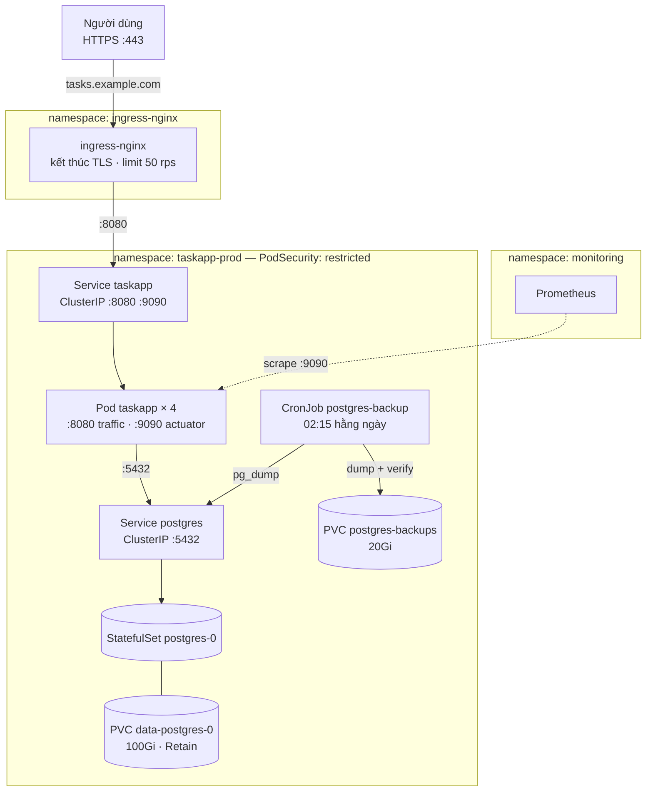
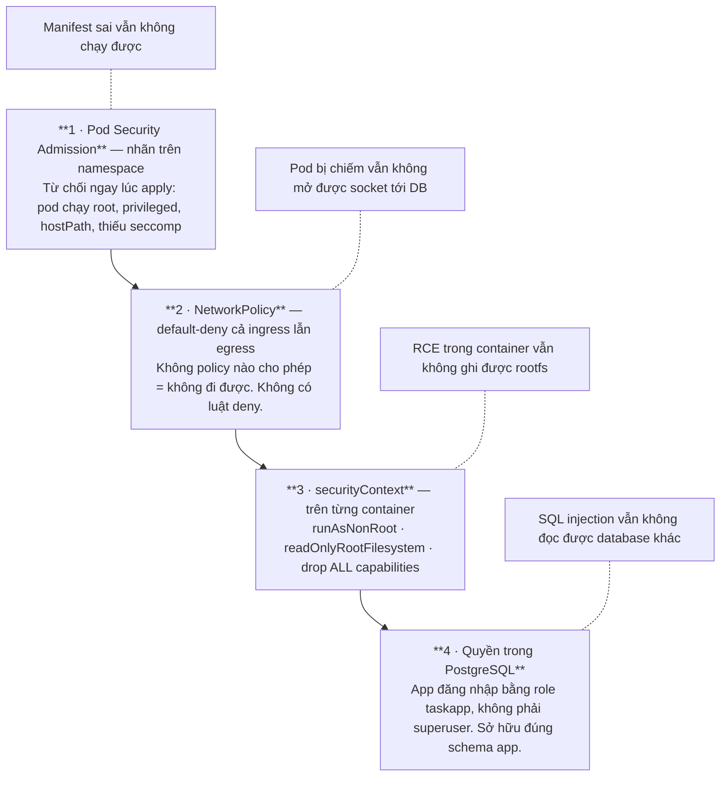
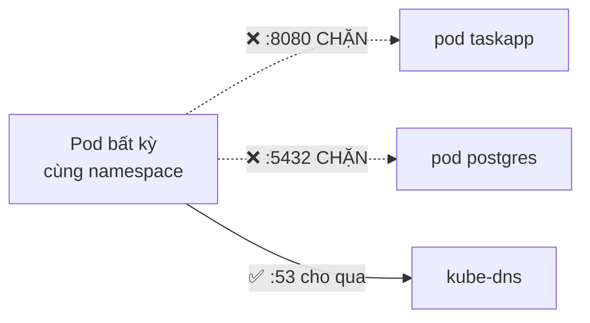
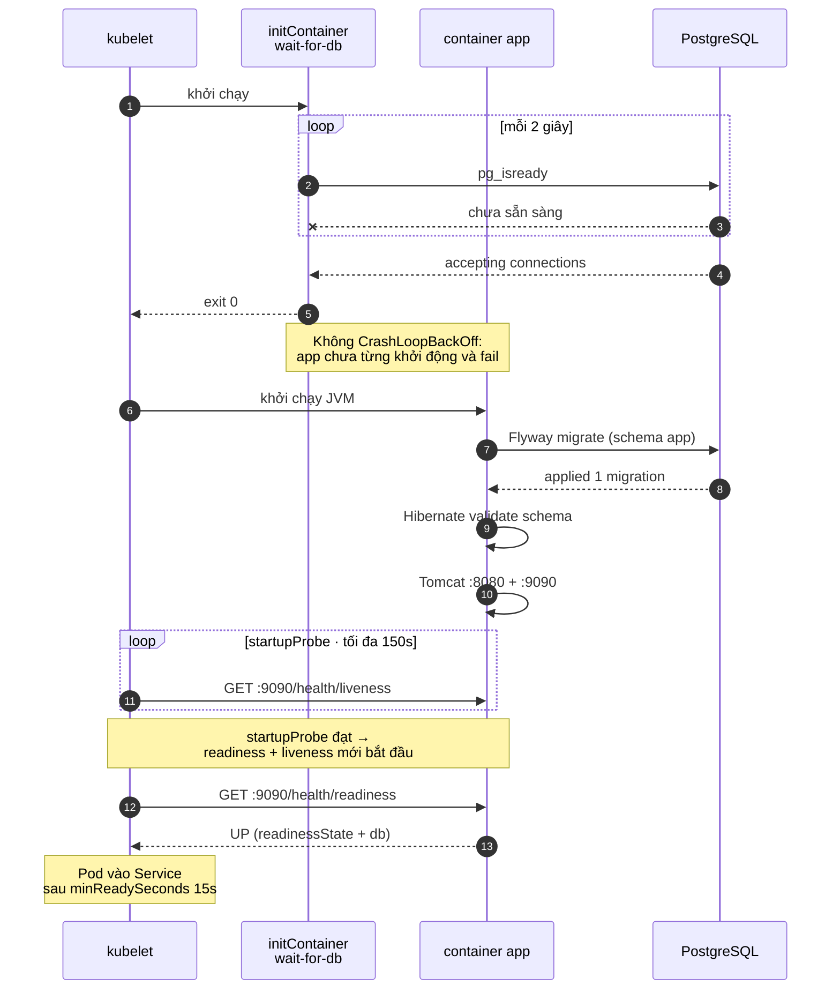
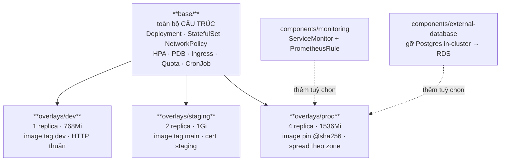
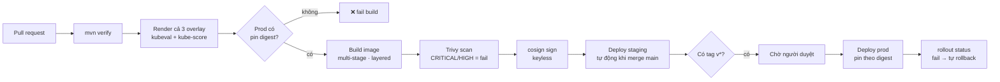

# Sơ đồ hệ thống

Sáu góc nhìn vào cùng một hệ thống. Sơ đồ render được trên GitHub, IDE và mọi trình
xem Markdown hỗ trợ Mermaid.

- Cái gì đã dựng → [`../../README_ARC.md`](README.md)
- Vì sao dựng vậy → [`DECISIONS.md`](DECISIONS.md)
- Lệnh vận hành → [`OPERATIONS.md`](OPERATIONS.md)

---

## 1. Đường đi của một request

**Điểm cần thấy:** không có đường nào từ ngoài vào thẳng `:9090`. Actuator chỉ tới
được từ namespace `monitoring`, và `/actuator/health` qua Ingress trả `404`.
Cổng `:5432` không có đường nào ra khỏi namespace.

---

## 2. Bốn lớp phòng thủ

Mỗi lớp giả định lớp trước đã thủng.

---

## 3. Ai được nói chuyện với ai

`default-deny-all` chặn tất cả trước, rồi mở đúng 5 đường:

| Từ | Tới | Cổng | Vì sao |
|---|---|---|---|
| `ingress-nginx` (namespace) | pod `taskapp` | 8080 | Traffic công khai |
| `monitoring` (namespace) | pod `taskapp` | 9090 | Prometheus scrape |
| pod `taskapp` | pod `postgres` | 5432 | Truy vấn dữ liệu |
| pod `postgres-backup` | pod `postgres` | 5432 | `pg_dump` hằng đêm |
| **mọi pod** | `kube-dns` | 53 | Không có thì không pod nào phân giải được tên |

Mọi thứ khác — pod này sang pod khác, egress ra Internet, namespace khác gọi vào —
đều bị chặn.

> Đã kiểm chứng thật trên Calico: pod lạ phân giải được DNS, nhưng `nc` tới
> `postgres:5432` và `taskapp:8080` đều thất bại. **CNI mặc định của minikube không
> thực thi NetworkPolicy** — policy vẫn apply thành công và không chặn gì cả.

---

## 4. Khởi động một pod

---

## 5. Tắt một pod — vì sao cần `preStop`

Hai việc chạy **song song, không ai chờ ai**. Đó là gốc của lỗi 502 khi deploy.

```mermaid
sequenceDiagram
    participant C as Ingress
    participant E as EndpointSlice<br/>controller
    participant K as kubelet
    participant A as container app

    Note over E,K: t=0 · Pod bị xoá — hai nhánh chạy song song

    par Nhánh A — kubelet
        K->>A: preStop.sleep 5s
        Note over A: vẫn phục vụ bình thường,<br/>chưa nhận SIGTERM
    and Nhánh B — mạng
        E->>E: gỡ pod khỏi EndpointSlice
        E->>C: cập nhật (eventually consistent, 1–3s)
    end

    Note over C: t≈3s · Ingress ngừng gửi request tới pod này

    K->>A: t=5s · SIGTERM
    A->>A: graceful shutdown ≤30s<br/>xử nốt request đang dở
    A-->>K: thoát sạch

    Note over K,A: terminationGracePeriodSeconds 60<br/>= 5 (preStop) + 30 (graceful) + 25 dự phòng
```

**Không có `preStop`:** nhánh A chạy trước nhánh B — app đóng listener trong khi
Ingress vẫn đang gửi request tới IP đó → client nhận RST.

> Đã đo thật: rolling restart với cấu hình này cho **799 request, 0 lỗi**.

---

## 6. Kustomize: một base, ba môi trường

**Quy tắc.** Overlay chỉ đổi **con số và tên miền**. Thêm/bớt *loại* cơ chế thì phải
là **component**, không phải patch — nếu không, staging thôi không còn chứng minh
được điều gì về prod.

---

## 7. Từ commit tới production

**Vì sao prod pin digest.** Tag là con trỏ, có thể bị đẩy đè — `:1.0.0` hôm nay và
mai có thể là hai binary khác nhau. Digest là hash nội dung, bất biến. Đó là điều
kiện để `rollout undo` quay về **đúng** những bytes đã từng chạy.
