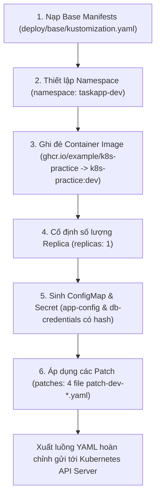
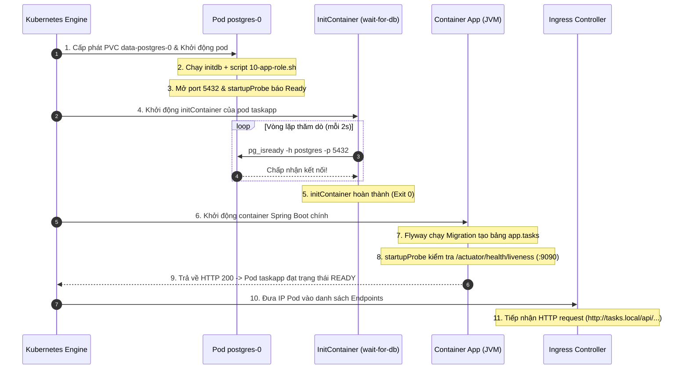

# Thứ Tự Thực Thi & Vòng Đời Triển Khai (Execution Order)

Tài liệu này mô tả chi tiết thứ tự xử lý, thứ tự nạp vào Kubernetes API Server và vòng đời khởi động thực tế trong cluster khi thực thi lệnh:

```powershell
kubectl apply -k deploy/overlays/dev
```

Quá trình này được chia thành **3 tầng thứ tự khác nhau**:

---

## 1. Tầng 1: Thứ Tự Biên Dịch Của Kustomize (Build Phase)

Trước khi gửi bất kỳ dữ liệu nào lên Kubernetes, công cụ **Kustomize** chạy cục bộ trên máy sẽ xử lý các file cấu hình theo thứ tự logic:



### Các bước biên dịch chi tiết:
1. **Nạp `../../base`:** Đọc file [`base/kustomization.yaml`](../../base/kustomization.yaml), kéo toàn bộ 16 manifest gốc cùng các script trong `files/`.
2. **Biến đổi Namespace (`namespace: taskapp-dev`):** Kustomize tự động chèn `namespace: taskapp-dev` vào toàn bộ các resource có phạm vi namespace.
3. **Biến đổi Image (`images`):** Thay thế registry URL gốc bằng image cục bộ `k8s-practice:dev`.
4. **Biến đổi Replica (`replicas`):** Ép số bản sao của Deployment `taskapp` từ 3 xuống 1.
5. **Bộ sinh cấu hình (Generators):**
   - `configMapGenerator`: Nạp các biến môi trường dev (`APP_ENV=dev`, JDBC URL với DNS của `taskapp-dev`) và script `10-app-role.sh`.
   - `secretGenerator`: Đọc file `secrets.env` cục bộ để tạo secret `db-credentials` (kèm mã hash gắn ở đuôi tên).
6. **Thực thi các file Patches:**
   - [`patch-dev-resources.yaml`](patch-dev-resources.yaml): Giảm RAM/CPU của app (`768Mi`), ép `imagePullPolicy: Never`; hạ RAM Postgres (`512Mi`); giảm PVC DB và PVC backup xuống 2Gi.
   - [`patch-dev-ingress.yaml`](patch-dev-ingress.yaml): Đổi domain sang `tasks.local`, xóa bỏ annotation cert-manager và tắt SSL redirect.
   - [`patch-dev-hpa.yaml`](patch-dev-hpa.yaml): Thu hẹp giới hạn scale: `minReplicas: 1, maxReplicas: 3`.
   - [`patch-dev-quota.yaml`](patch-dev-quota.yaml): Thu nhỏ trần tài nguyên namespace phù hợp với Minikube.

---

## 2. Tầng 2: Thứ Tự Nạp Vào API Server (Apply & Admission Phase)

Khi nhận được luồng YAML tổng hợp từ Kustomize, Kubernetes API Server **không nạp ngẫu nhiên** mà áp dụng theo độ ưu tiên phụ thuộc tài nguyên (Dependency Order):

| Thứ tự | Loại tài nguyên (Kind) | File manifest / Đối tượng tương ứng | Mục đích & Lý do ưu tiên |
|:---:|---|---|---|
| **1** | `Namespace` | [`base/namespace.yaml`](../../base/namespace.yaml) | Phải có không gian tên `taskapp-dev` trước để chứa các object khác. |
| **2** | `ResourceQuota` & `LimitRange` | [`base/limitrange.yaml`](../../base/limitrange.yaml)<br>[`patch-dev-quota.yaml`](patch-dev-quota.yaml) | Dựng khung kiểm soát tài nguyên để Admission Webhook kiểm tra Pod sắp tạo. |
| **3** | `Secret` & `ConfigMap` | Sinh bởi `secretGenerator` & `configMapGenerator` | Cung cấp file cấu hình và mật khẩu DB để container mount vào lúc boot. |
| **4** | `ServiceAccount` | [`base/app-serviceaccount.yaml`](../../base/app-serviceaccount.yaml) | Cung cấp danh tính bảo mật cho Pod ứng dụng. |
| **5** | `NetworkPolicy` | [`base/networkpolicy-default-deny.yaml`](../../base/networkpolicy-default-deny.yaml)<br>[`base/app-networkpolicy.yaml`](../../base/app-networkpolicy.yaml)<br>[`base/db-networkpolicy.yaml`](../../base/db-networkpolicy.yaml) | Khóa tường lửa Zero-Trust và mở whitelist luồng mạng trước khi workload chạy. |
| **6** | `Service` | [`base/db-service.yaml`](../../base/db-service.yaml) (headless)<br>[`base/app-service.yaml`](../../base/app-service.yaml) | Khởi tạo IP ảo và bản ghi CoreDNS nội bộ (`postgres`, `taskapp`). |
| **7** | `PersistentVolumeClaim` | [`base/db-backup-cronjob.yaml`](../../base/db-backup-cronjob.yaml) (backup PVC 2Gi) | Chuẩn bị sẵn ổ đĩa lưu trữ cho CronJob backup. |
| **8** | `StatefulSet` & `Deployment` & `CronJob` | [`base/db-statefulset.yaml`](../../base/db-statefulset.yaml)<br>[`base/app-deployment.yaml`](../../base/app-deployment.yaml)<br>[`base/db-backup-cronjob.yaml`](../../base/db-backup-cronjob.yaml) | Khởi tạo các Pod cơ sở dữ liệu, ứng dụng backend và job sao lưu. |
| **9** | `PodDisruptionBudget` & `HPA` | [`base/app-pdb.yaml`](../../base/app-pdb.yaml), [`base/db-pdb.yaml`](../../base/db-pdb.yaml)<br>[`patch-dev-hpa.yaml`](patch-dev-hpa.yaml) | Gán cơ chế bảo vệ chống gián đoạn và tự động co giãn cho Pod. |
| **10** | `Ingress` | [`patch-dev-ingress.yaml`](patch-dev-ingress.yaml) | Mở đường định tuyến HTTP từ bên ngoài vào Service. |

---

## 3. Tầng 3: Thứ Tự Khởi Động Thực Tế Trong Cụm (Runtime Lifecycle Order)

Dù lệnh `kubectl apply` hoàn tất gửi dữ liệu lên etcd chỉ sau vài giây, nhưng ở **tầng Runtime trong cụm**, các container sẽ khởi động và chuyển sang `Ready` theo chuỗi nhân quả sau:



### Chi tiết các cột mốc Runtime:
1. **Cột mốc 1: PostgreSQL sẵn sàng trước**
   - Pod `postgres-0` gắn ổ đĩa PVC `data-postgres-0`.
   - Entrypoint chạy script [`files/10-app-role.sh`](../../base/files/10-app-role.sh) để khởi tạo role `taskapp` và gán quyền trên schema `app`.
   - `startupProbe` xác nhận port 5432 đã mở $\rightarrow$ `postgres-0` chuyển sang `Ready`.
2. **Cột mốc 2: Backend chờ DB thông qua `initContainer`**
   - Pod `taskapp` bắt đầu chạy `initContainers: wait-for-db`.
   - Container này chạy vòng lặp lệnh `pg_isready` thăm dò cổng `postgres:5432`.
   - **Tác dụng:** Giữ Pod ở trạng thái `Init:0/1` cho đến khi Postgres sẵn sàng, loại bỏ hoàn toàn lỗi Spring Boot bị crash vì mất kết nối DB lúc khởi động.
3. **Cột mốc 3: JVM khởi động & Flyway Migration**
   - Khi initContainer kết thúc thành công, container chính Java Spring Boot mới bắt đầu được nạp.
   - Spring Boot chạy **Flyway Migration** để tạo cấu trúc bảng dữ liệu (`app.tasks`).
   - `startupProbe` thăm dò endpoint `/actuator/health/liveness` qua cổng 9090. Khi nhận được HTTP 200, Pod chính thức chuyển sang trạng thái `Ready`.
4. **Cột mốc 4: Lưu lượng người dùng được kích hoạt**
   - Kubelet báo cáo Pod `taskapp` đã Ready.
   - Kube-proxy cập nhật IP của Pod vào Service Endpoints.
   - **Ingress Controller** bắt đầu chuyển tiếp request từ người dùng bên ngoài vào Pod Backend.

---

## 4. Hướng Dẫn Vận Hành Theo Thứ Tự Chuẩn

Vì thứ tự Runtime ở trên, khi theo dõi quá trình triển khai, kỹ sư vận hành bắt buộc phải chờ theo thứ tự nhân quả:

```powershell
# BƯỚC 1: Apply toàn bộ manifest đã render
kubectl apply -k deploy/overlays/dev

# BƯỚC 2: Phải chờ Database Ready TRƯỚC (tối đa 10 phút cho lần khởi tạo đầu tiên)
kubectl -n taskapp-dev rollout status statefulset/postgres --timeout=600s

# BƯỚC 3: Sau đó mới chờ Backend App Ready
kubectl -n taskapp-dev rollout status deployment/taskapp --timeout=600s

# BƯỚC 4: Kiểm tra trạng thái toàn diện
kubectl -n taskapp-dev get pods,svc,ingress,hpa,pdb,netpol,pvc
```

> [!WARNING]
> Nếu bạn đảo ngược thứ tự (chờ App trước Database), lệnh chờ của bạn sẽ bị treo vì App đang bị giữ chân tại `initContainers: wait-for-db`. Tuân thủ đúng thứ tự giúp phát hiện sự cố ngay tại tầng gốc.
